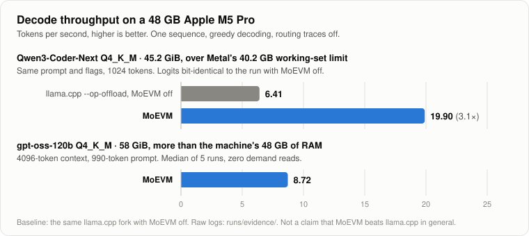
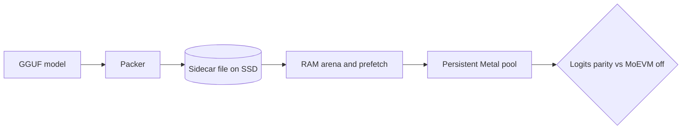

# MoEVM

**Expert paging for Mixture-of-Experts LLMs on Apple Silicon.** MoEVM runs MoE
models whose routed experts do not fit in GPU memory on a 48 GB Mac. Expert
weights are packed into a sidecar file and paged on demand into a persistent
Metal pool, inside a fork of [llama.cpp](https://github.com/ggml-org/llama.cpp).
Every result is checked bit for bit against the same build with MoEVM off.



- **Qwen3-Coder-Next Q4_K_M (45.2 GiB, more than the 40.2 GB Metal working-set
  limit of this Mac):** **6.41 → 19.90 tok/s** decode (3.1×) against the same
  llama.cpp build with MoEVM off: same prompt, 1024 tokens, routing traces off
  on both sides. Logits are bit-identical at all 1024 positions over the full
  151,936-token vocabulary.
- **gpt-oss-120b Q4_K_M (58 GiB, more than the 48 GB of RAM):** **8.72 tok/s**
  decode, median of 5 runs at a 4096-token context with a 990-token prompt, with
  zero demand reads and no memory-pressure events. Four parallel sequences
  reach 26.81 tok/s in aggregate.
- **Not a general speedup:** when the model fits in memory, plain llama.cpp is
  faster (see [Limits](#limits)).

Status: research prototype, measured on one machine. The 6-hour stability soak
was never completed. The story behind the numbers, including what failed, is in
[the write-up](docs/WRITEUP.md).

## Quick start

On an Apple Silicon Mac with 48 GB of memory, Xcode command line tools, CMake
and Python 3:

```bash
git clone https://github.com/Takinggg/moevm.git && cd moevm
./scripts/build.sh
python3 scripts/bench.py qwen3-coder-next-q4
```

`build.sh` clones the fork into `external/llama.cpp` and builds
`llama-moe-trace` (about a minute on an M5 Pro). `bench.py` checks the machine,
prints the download command if the model is missing, packs the sidecar on first
use, then runs llama.cpp with MoEVM off and on, alternating, three times each.
It compares the logits of every off/on pair and prints a table like this:

```text
| Mode | Runs | Median tok/s | Min | Max | Published |
|---|---:|---:|---:|---:|---:|
| llama.cpp --op-offload, MoEVM off | 3 | ... | ... | ... | 6.41 |
| MoEVM on | 3 | ... | ... | ... | 19.90 |

Speedup (median on / median off): ...x (published 3.10x)
Logits parity: 3/3 pairs bit-identical over 1024 rows x 151936 vocab; worst max_abs=0.0
MoEVM runtime_errors: 0
```

Download the model first (45.2 GiB; the sidecar needs about as much again):

```bash
hf download unsloth/Qwen3-Coder-Next-GGUF Qwen3-Coder-Next-Q4_K_M.gguf --local-dir ~/models/qwen3-coder-next-q4
```

`python3 scripts/bench.py gpt-oss-120b` runs the 4096-context median of 5
through the same harness that produced the published number. Models live in
`~/models` by default; set `MOEVM_MODELS_DIR` to use another directory, and
`MOEVM_LLAMA_BIN` to use another `llama-moe-trace` build. Every run goes
through [`phase0/safe_run.py`](phase0/safe_run.py), which stops a run before
memory pressure becomes dangerous and refuses to start while Docker or a VM is
using memory (`--allow-docker` overrides it, at your own risk).

`python3 -m unittest discover -s tests` checks the benchmark pipeline without a
model or GPU.

## How it works



1. **Packer.** [`phase0/model_profile.py`](phase0/model_profile.py) reads the
   GGUF tensor table and checks that the model's expert layout is supported
   ([`MODEL_CAPABILITIES.md`](phase0/MODEL_CAPABILITIES.md)). The
   `sidecar_*.py` tools then copy every routed expert into one contiguous file,
   indexed by `(layer, expert, component)`, with the sidecar's size and a
   SHA-256 prefix recorded in the index. Packing runs at about 1 GiB/s.
2. **RAM arena and prefetch.** A C++ runtime
   ([`phase0/moevm_runtime.cpp`](phase0/moevm_runtime.cpp)) keeps a bounded
   arena of expert records in RAM, with LRU eviction and prefetch of candidate
   experts. Under macOS memory pressure it gives pages back with
   `MADV_FREE_REUSABLE` instead of waiting for the system to kill the process.
3. **Persistent Metal pool.** In the llama.cpp fork, the routed `MUL_MAT_ID`
   nodes of the compute graph are rewritten to read from a pool of Metal
   buffers. A scheduler hook reads the selected expert ids once per layer, fills
   the pool from the arena, patches the graph for that split and restores it
   afterwards. Epochs and pinning keep an expert from being evicted while a
   graph still uses it.
4. **Logits parity.** A result counts only if the full logits match the same
   build with MoEVM off. Matching tokens is not enough.

On 512-token coding traces of gpt-oss with a 28 GiB budget, plain LRU hits
95.10–95.75% of expert accesses against 97.15–97.49% for the offline-optimal
Belady policy ([RUNBOOK](phase0/RUNBOOK.md)). A smarter cache policy has little
left to win; the bottleneck is CPU and scheduler rendezvous, mostly reading the
selected expert ids back from the GPU.

## Results

Machine: MacBook Pro, Apple M5 Pro, 48 GB unified memory. Greedy decoding
(`--temp 0`); single-sequence rows use `-b 1 -ub 1`. Throughput is the decode
tok/s printed by `llama-moe-trace`, with routing traces off.

| Model | Configuration | Decode tok/s | Correctness | Source |
|---|---|---:|---|---|
| Qwen3-Coder-Next Q4_K_M, 45.2 GiB | llama.cpp `--op-offload`, MoEVM off, 1024 tokens | 6.41 | reference | [log](runs/evidence/qwen3_next_q4_p0d_parity_stock_ignoreeos_n1024_v2.log) |
| | **MoEVM pool**, same command plus `--moevm-*` flags | **19.90** | logits bit-identical, 1024 rows | [log](runs/evidence/qwen3_next_q4_p0d_parity_moevm_cap128_ignoreeos_n1024.log), [parity](runs/qwen3_next_q4_p0d_parity_stock_vs_moevm_n1024.json) |
| gpt-oss-120b Q4_K_M, 58 GiB | **MoEVM graph pool**, 24 GiB arena, 4096 context, 1 sequence | **8.72** (median of 5) | `demand_reads=0`, `runtime_errors=0` in all 5 runs | [runs](runs/evidence/gpt_oss_120b_median5_observability_24g_20260705/), [summary](runs/gpt_oss_120b_median5_observability_24g_20260705.md) |
| | MoEVM graph pool, 4 parallel sequences, same prompt | 26.81 aggregate (6.70 per sequence) | `runtime_errors=0` | [log](runs/evidence/gpt_oss_120b_parallel4_observability_n32.log), [summary](runs/gpt_oss_120b_parallel4_aggregate_20260705.md) |

Logits parity (full-vocabulary logits compared at every decoded position):

| Model | Comparison | Rows | `max_abs` | Source |
|---|---|---:|---:|---|
| Qwen3-Coder-Next Q4_K_M | MoEVM off vs on (the head-to-head above) | 1024 | 0.0 | [json](runs/qwen3_next_q4_p0d_parity_stock_vs_moevm_n1024.json) |
| Qwen3-Coder-Next Q4_K_M | Later graph-build pool, off vs on | 50 | 0.0 | [json](runs/evidence/qwen3_next_q4_graph_parity_off_vs_sched_n50.json) |
| gpt-oss-120b Q4_K_M | Same-backend Metal reference vs MoEVM | 64 | 0.0 | [json](runs/evidence/gpt_oss_120b_q4_metal_opoffload_vs_moevm_n64_logits_compare.json) |

How to read these numbers:

- The Qwen pair differs only by the `--moevm-*` flags: same fork binary
  (`llama-moe-trace`), prompt, seed, 1536-token context, and `-ngl 99
  --op-offload` with routed experts on CPU. The baseline relies on the
  sparse-mmap loader fix from
  [#25309](https://github.com/ggml-org/llama.cpp/pull/25309); without it this
  placement ran out of Metal memory.
- The parallel figure is aggregate throughput over 32 decode steps per
  sequence; it does not lower single-sequence latency.
- The lab notes in [`phase0/RUNBOOK.md`](phase0/RUNBOOK.md) and
  [`runs/*.md`](runs/) record every intermediate measurement, including runs
  with routing traces on, warm-cache replays and superseded figures. The tables
  above are the reference numbers. In particular, the best earlier gpt-oss
  single runs were faster than 8.72 tok/s; the median of five at 4096 context
  replaces them.
- [`runs/evidence/`](runs/evidence/) holds the raw logs behind each row, with
  only local paths redacted.

## Limits

- **When the model fits in memory, plain llama.cpp wins.** Qwen3-Coder-Next Q3
  (36.3 GB) fits fully on Metal: `llama-bench` decodes it at 49.69 tok/s
  ([log](runs/evidence/qwen3_next_q3_fullresident_llamabench_decode128.log)),
  against 11.76–11.95 tok/s through MoEVM
  ([notes](phase0/LLAMA_INTEGRATION.md#full-resident-baseline)). MoEVM is for
  models that do not fit.
- **CPU-only llama.cpp is competitive on gpt-oss.** With `-ngl 0`, 512–1024-token
  contexts and 47–67-token prompts (routing traces on), it decodes gpt-oss-120b
  at 10.85–14.36 tok/s
  ([summary](runs/gpt_oss_120b_q4_benchmark_summary.md#trace)). That is a
  shorter context than the 8.72 tok/s run, so the two are not directly
  comparable, but MoEVM's measured gain is against the GPU/Metal paths, with
  bounded memory.
- **Upstream status.** Only the loader fix is proposed upstream, as draft PR
  [ggml-org/llama.cpp#25309](https://github.com/ggml-org/llama.cpp/pull/25309).
  The MoEVM runtime itself lives in a fork.
- Qwen3-Coder-Next (45.2 GiB) fits in the 48 GB of RAM; what it exceeds is
  Metal's 40.2 GB working-set limit. Only gpt-oss-120b is larger than RAM.
- Measured on one machine. Other Apple Silicon configurations are untested.
- Routed MoE weights only: dense models have no small active set per token.
- The packer supports split `gate/up/down` routed expert tensors. Fused
  `gate_up` or custom expert layouts need a layout adapter first, and every new
  model needs a capability profile and a parity run before any throughput claim.
- Throughput depends on the workload's expert locality.
- Batch and parallel modes can raise aggregate throughput but do not reproduce
  the exact `b=1` token stream.

## Repository layout

| Path | Contents |
|---|---|
| [`scripts/`](scripts/) | `build.sh` (clone and build the fork) and `bench.py` (reproduce the results). |
| [`phase0/`](phase0/) | Python tooling (GGUF inspection, capability profile, sidecar plan/pack/index, cache and prefetch simulators, quality harnesses, `safe_run.py`) and the C++ runtime (`moevm_runtime.*`, replay tools). Standard library only. |
| [`runs/`](runs/) | Benchmark summaries, comparison JSONs, prompts, and [`runs/evidence/`](runs/evidence/). |
| [`docs/`](docs/) | [Write-up](docs/WRITEUP.md), [FAQ](docs/FAQ.md), the pre-registered [soak criteria](docs/SOAK_CRITERIA.md), and the results chart. |
| [`tests/`](tests/) | Benchmark pipeline tests that need no model or GPU. |

The runtime integration (graph rewrite, scheduler hook, `llama-moe-trace`)
lives on the fork branch
[`Takinggg/llama.cpp@codex/moevm-graph-build`](https://github.com/Takinggg/llama.cpp/tree/codex/moevm-graph-build).
The tag
[`moevm-p0d-audit-hardened`](https://github.com/Takinggg/llama.cpp/releases/tag/moevm-p0d-audit-hardened)
marks the audited runtime that recorded the Qwen head-to-head in July 2026.

## Status

Research prototype; the reference measurements date from July 2026.

- Done: sidecar packing with integrity-checked indexes; graph-build Metal pool
  with epochs and pinning; logits parity gates plus jitter and fence stress
  tests; the `safe_run.py` memory guard; gpt-oss-120b decoding on a 48 GB Mac.
- **The 6-hour soak was never completed.** Only a pilot of about 30 minutes ran
  on 2026-07-05 before it was stopped on purpose, and its validation was never
  finished. The final soak defined in [`docs/SOAK_CRITERIA.md`](docs/SOAK_CRITERIA.md)
  has not been run, so long-run stability is not established.
- Release check (2026-10-18): `build.sh` was tested from a fresh clone and
  `tests/` pass. `bench.py` has not yet been re-run end to end on the real
  models for this release.
- Next: rewriting expert-id readback and orchestration, the main remaining
  throughput lever. It moves the epoch fence and needs a full parity and soak
  campaign.

## License

MIT, see [LICENSE](LICENSE). The llama.cpp fork keeps llama.cpp's MIT license;
its notice is reproduced in the same file.
